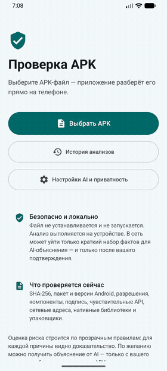

# APK AI Analyzer

**APK AI Analyzer** — Android-приложение для проверки APK-файлов на подозрительное поведение.
Пользователь выбирает APK, а приложение **безопасно исследует его прямо на телефоне — не устанавливая и не запуская**:
показывает, что внутри, объясняет подозрительные признаки простыми словами и (в следующих версиях) выставляет
объяснимую оценку риска и формирует отчёт с AI-объяснением.

📄 Полный план продукта: [docs/pdf/APK-AI-Analyzer-Product-Plan-RU.pdf](docs/pdf/APK-AI-Analyzer-Product-Plan-RU.pdf)

## Демонстрация

<p align="center">
  
</p>

🎬 Полное видео (3,5 мин): [docs/pdf/APK-AI-Analyzer-demo.mp4](docs/pdf/APK-AI-Analyzer-demo.mp4) —
анализ подозрительного APK и доказательства, PDF-отчёт в приложении, настройка AI, история, чистое приложение,
настройки приватности. Видео записано на эмуляторе Android 16 на синтетических образцах из `samples/synthetic/`.

---

## Что реализовано сейчас

### Этап 1 — локальный анализ APK ✅

Приложение выбирает APK через системный диалог, копирует его во временную закрытую папку, разбирает и показывает
**сырые признаки** — пока без итоговой оценки риска.

**Что извлекается из APK**

| Область | Что именно |
|---|---|
| Файл | имя, размер, **SHA-256** |
| Приложение | пакет, версия, minSdk / targetSdk, класс Application, `debuggable`, `testOnly`, `allowBackup`, `usesCleartextTraffic`, `sharedUserId`, наличие иконки в лаунчере |
| Разрешения | полный список с категориями (SMS, геолокация, камера/микрофон, администрирование и т.д.) |
| Компоненты | activities, services, receivers, providers; **exported** с учётом правил Android по умолчанию; intent-фильтры, authorities, защитные разрешения |
| Подпись | схемы **v1 / v2 / v3 / v3.1**, сертификаты (владелец, срок, алгоритм, SHA-256), отладочный сертификат, публичный тестовый ключ AOSP |
| Код (DEX) | все `classes*.dex`: строки, типы, ссылки на методы; **46 чувствительных API** (отправка SMS, IMEI, `Runtime.exec`, `DexClassLoader`, Accessibility, Device Admin, захват экрана, скрытие иконки…); доля обфусцированных имён |
| Сеть и строки | URL, домены, IP-адреса (публичные / локальные), shell-команды, системные пути, `content://` URI — из DEX и текстовых ресурсов |
| Содержимое | нативные библиотеки и ABI, **известные упаковщики** (Jiagu, Bangcle, Ijiami, Legu, DexProtector…), **скрытый код** в assets (DEX/APK/ELF, в том числе под видом картинок) |
| Структура архива | аномалии: фальшивый флаг шифрования, нестандартное сжатие, дубликаты записей, `../` в путях, подменённые имена атрибутов манифеста |
| Полнота анализа | каждый этап имеет статус; итоговая «полнота анализа» в процентах и список ограничений |

**Безопасность анализа**

- APK не устанавливается и не исполняется. Анализ полностью локальный; сеть используется только для
  AI-объяснения (этап 4) — после явного согласия, по HTTPS и без отправки самого APK.
- Временная копия файла удаляется сразу после анализа; история и настройки исключены из облачных бэкапов.
- Защита от вредоносных архивов: лимиты размера и числа записей, детектор **zip-bomb** (коэффициент сжатия +
  общий бюджет распаковки), проверка **CRC32**, разбор ZIP по правилам установщика Android.
- Каждый этап изолирован: испорченный DEX или подпись не обрушивают анализ, а снижают полноту.
- Анализ можно **отменить** на любом этапе.

**Интерфейс**: главный экран → выбор файла → прогресс по этапам с отменой → экран признаков по разделам
(цветом выделено то, что требует внимания). Тёмная/светлая тема, русский язык.

**Качество**: 42 автотеста ядра, включая **фаззинг на 1500 случайно испорченных APK** (ни одного падения),
тесты zip-bomb, повреждённых архивов, отмены и воспроизводимости результата.

### Этап 2 — движок правил и оценка риска ✅

По фактам из этапа 1 приложение выставляет **одну из четырёх категорий** — «Низкий риск», «Нужно внимание»,
«Высокий риск», «Недостаточно данных» — и показывает **причины с доказательствами**.

- **49 правил** (версия набора `2026.10.1`, записывается в результат):
  - **39 одиночных признаков** в 11 поведенческих группах: SMS и звонки, слежка, сбор данных, скрытый
    автозапуск, загрузка кода, контроль устройства (Accessibility, Device Admin), фишинг и оверлеи, сокрытие
    и обфускация, root, сеть (зашитые IP, подозрительные домены, Telegram/Discord как канал слива), качество сборки;
  - **10 связок** — типичные схемы: кража SMS, SMS-мошенничество, банковский троян через Accessibility,
    шпион, дроппер, блокировщик, скрытая работа в фоне, перехват кодов, root-набор, сбор и отправка данных.
- **Связка весит больше суммы частей**: `INTERNET` сам по себе ничего не значит, `READ_SMS` — повод
  присмотреться, а `READ_SMS` + сеть + скрытая иконка — уже сильный сигнал.
- **Смягчающие контексты** снижают вес, но не удаляют доказательство: SMS-клиент по умолчанию, приложение
  для звонков, клавиатура/обои/лаунчер без иконки.
- **Формула**: вклад правила = вес × уверенность × смягчения; итог = 1 − Π(1 − вкладᵢ/100). Много обычных
  разрешений (как у мессенджера) не дают тревоги; «Нужно внимание» требует хотя бы одного весомого признака.
- **«Недостаточно данных»**: манифест или код не прочитаны, код скрыт упаковщиком, полнота анализа < 60%.
- **Воспроизводимость**: одинаковый файл и версия правил — одинаковый результат.
- **Экран результата**: карточка категории и балла → причины (раскрываются в доказательства: что найдено
  и где, вес, уверенность, смягчения) → все сырые признаки.
- **Тесты**: на каждое правило есть свой минимальный APK; отдельно проверяются связки, смягчения, пороги,
  «мессенджер остаётся низким», детерминизм. Всего в ядре **59 тестов**.

> Пороги и веса откалиброваны на синтетических примерах. Следующий шаг калибровки — прогон на размеченном
> наборе реальных APK (чистые с F-Droid + вредоносные из исследовательских наборов) с замером
> ложных срабатываний и пропусков.

### Этап 3 — отчёты, история, действия ✅

- **Единый формат отчёта** (`ReportDocument`): из него строятся экран результата, запись истории, JSON и PDF —
  все четыре представления гарантированно совпадают. Отчёт собирает приложение из локальных доказательств;
  поле для будущего AI-объяснения хранится отдельно и помечено как текст модели.
- **Рекомендации «Что делать»** в зависимости от результата: не устанавливать, удалить, отключить права
  администратора или «Специальные возможности», связаться с банком и т.д.
- **История анализов** (Room): каждый анализ сохраняется автоматически — только отчёт, сам APK никогда.
  Список с цветом риска, открытие сохранённого отчёта, удаление записи, очистка истории.
- **Просмотр PDF-отчёта прямо в приложении** (системный PdfRenderer, масштаб до 250%, сохранить/отправить из просмотра).
- **Экспорт**: «Сохранить PDF» и «Сохранить JSON» в выбранное пользователем место (системный диалог),
  «Поделиться отчётом» (PDF через FileProvider). PDF рисуется средствами Android (A4, перенос между
  страницами, колонтитул с версиями и SHA-256). JSON содержит SHA-256, время, версии приложения/анализатора/
  правил, вывод, доказательства, рекомендации и ограничения; повторная сериализация стабильна байт в байт.
- **Действия**: удалить выбранный файл APK (через провайдер документов, после подтверждения), открыть
  системный диалог удаления установленного приложения, открыть его системные настройки.
- **Доступность**: заголовки для экранных дикторов, объединённое описание карточки риска, состояние
  «раскрыто/свёрнуто» у причин, объявление текущего этапа анализа.
- В ядре **64 теста** (добавлены JSON, формат отчёта, рекомендации).

### Этап 4 — AI-объяснение ✅

- **Провайдеры**: DeepSeek, OpenAI, Google Gemini или любой OpenAI-совместимый API (свой адрес). Можно
  создать несколько **AI-профилей** (провайдер + модель + ключ) и выбрать активный.
- **Свой API-ключ** хранится только на телефоне: шифруется AES-256-GCM мастер-ключом из **Android Keystore**,
  не попадает в отчёты, историю, логи и резервные копии. В APK никаких ключей не встроено.
- **«Проверить подключение»** — запрашивает только список моделей, без данных APK; модели можно выбрать из списка.
- **Что уходит в AI** — только JSON с фактами: вывод движка, сработавшие правила, категории разрешений, типы
  открытых компонентов, чувствительные API и **не больше 20** коротких очищенных фрагментов. **Не уходят**:
  сам APK, имя файла, SHA-256, пути и данные устройства. Похожее на токены, ключи, почту и телефоны маскируется;
  домены и IP по умолчанию заменяются на `<домен>`/`<IP>` (передача включается в настройках).
- **Согласие и предпросмотр**: при первом запросе пользователь видит точный JSON и адрес назначения и явно
  соглашается; предпросмотр можно оставить для каждого запроса. Согласие можно отозвать.
- **Четыре отдельных версионируемых запроса**: объяснение находок, предполагаемое поведение (только сценарии
  с доказательствами и указанием уверенности), рекомендации, текст отчёта. Версии промптов записываются в отчёт.
- **Защита от инъекций** через строки внутри APK: факты передаются как данные в отдельном блоке, системный
  промпт запрещает выполнять инструкции из них, ответ — строго JSON фиксированной схемы, неизвестные правила
  и ссылки из ответа отбрасываются, некорректный ответ отклоняется.
- **AI не меняет оценку**: категория, балл и доказательства остаются от локального движка; объяснение хранится
  отдельно и везде помечено «Сгенерировано моделью». Без AI приложение полностью работает.
- **Надёжность**: таймауты, повтор при временных ошибках (сеть, 429, 5xx), откат без JSON-режима для моделей,
  которые его не поддерживают, только HTTPS (cleartext запрещён), без перехода по редиректам.
- AI-объяснение можно получить и для свежего анализа, и для отчёта из истории; оно сохраняется в историю,
  PDF и JSON (схема отчёта v2, старые отчёты читаются).
- **Настройки**: AI-профили, приватность (предпросмотр, домены, имя пакета, отзыв согласия), срок хранения
  истории (бессрочно / 30 / 90 дней / год).
- В ядре **81 тест** (добавлены факты для AI, маскирование, промпты, проверка ответов, повторы, ошибки ключа,
  откат JSON-режима, «AI не меняет вердикт»).

### Дальше по плану

| Этап | Содержание | Статус |
|---|---|---|
| 1 | Прототип локального анализа | ✅ готов |
| 2 | Движок правил: веса, комбинации признаков, смягчающие контексты, уровень риска с доказательствами | ✅ готов |
| 3 | История анализов (Room), экспорт отчёта PDF/JSON, удаление файла, системные действия | ✅ готов |
| 4 | AI-объяснение: DeepSeek / OpenAI / Gemini / совместимый API, свой API-ключ (Android Keystore), согласие и предпросмотр отправляемых фактов | ✅ готов |
| 5 | Проверка установленных приложений | ⏳ |

---

## Архитектура

```
APKAnalyzer/
├── core/   — чистый Kotlin/JVM, без Android: анализатор, правила, модели (покрыт тестами)
│   └── com.apkanalyzer
│       ├── analyzer/            ApkAnalyzer — этапы анализа, лимиты, отмена, полнота
│       │   ├── archive/         SafeApkArchive — «недоверчивый» ZIP-читатель
│       │   ├── axml/            BinaryXmlParser — бинарный AndroidManifest.xml
│       │   ├── manifest/        ApkManifest + ManifestParser
│       │   ├── signature/       SignatureInspector — v1/v2/v3/v3.1
│       │   ├── dex/             DexInspector + каталог чувствительных API
│       │   ├── strings/         IndicatorExtractor — URL, домены, IP, команды
│       │   ├── contents/        нативный код, упаковщики, скрытые payload'ы
│       │   └── report/          RawFeatureFormatter — секции экрана признаков
│       ├── rules/               RuleCatalog (правила), RiskEngine (оценка), ApkFacts, категории разрешений
│       ├── report/              ReportDocument, ReportBuilder, ReportJson, рекомендации
│       ├── domain/model/        RiskLevel
│       └── ai/                  AI: факты и очистка, промпты, протокол, проверка ответов, клиент
├── app/    — Android: Kotlin, Jetpack Compose, Material 3
│   └── com.apkanalyzer
│       ├── data/importer/       ApkImporter — SAF → временная закрытая копия
│       ├── data/history/        история анализов (Room)
│       ├── data/export/         PDF-рендер и просмотр, экспорт/«Поделиться», удаление файла, системные действия
│       ├── data/ai/             ключи в Android Keystore, HTTPS-транспорт, AiService
│       ├── data/settings/       настройки, AI-профили, согласия (DataStore)
│       ├── ui/                  главная, анализ, отчёт, AI, история, настройки, тема
│       └── di/                  контейнер зависимостей
├── samples/                     образцы APK для ручной проверки (файлы в git не попадают)
└── docs/pdf/                    план продукта и демо-видео
```

Ядро анализатора отделено от Android, поэтому его можно тестировать обычными JVM-тестами и переиспользовать
(например, в будущей серверной части).

**Стек**: Kotlin 2.4 · Jetpack Compose + Material 3 · Coroutines · Navigation Compose · Room + KSP · DataStore · AGP 9.4 · Gradle 9.6 ·
minSdk 26 (Android 8.0) · targetSdk 36.

---

## Как запустить

**Нужно**: Android Studio (JDK встроен), Android SDK Platform 37, Build-Tools 36.0.0, эмулятор с образом
Android 16 (API 36.1, Google APIs, x86_64). Kotlin и Gradle отдельно ставить не нужно.

```powershell
.\gradlew.bat :core:test           # автотесты анализатора
.\gradlew.bat :app:assembleDebug   # debug APK → app\build\outputs\apk\debug\app-debug.apk
```

Или просто кнопка **Run ▶** в Android Studio.

### Проверка на образцах

В `samples/synthetic/` лежат безопасные синтетические APK (генерируются `SampleApkGenerator` в тестах `core`):
подозрительный (SMS + автозапуск + скрытая иконка + C2-адреса), чистый, обрезанный, с испорченными данными,
zip-bomb, «не APK», ZIP без манифеста. Закинуть их на запущенный эмулятор:

```powershell
$adb = "$env:LOCALAPPDATA\Android\Sdk\platform-tools\adb.exe"
& $adb shell mkdir -p /sdcard/Download/apk-samples
Get-ChildItem samples -Recurse -Filter *.apk | ForEach-Object { & $adb push $_.FullName "/sdcard/Download/apk-samples/$($_.Name)" }
& $adb shell content call --method scan_volume --uri content://media --arg external_primary
```

Затем в приложении: **«Выбрать APK» → Downloads → apk-samples**.

Настоящие вредоносные APK в репозиторий не добавляются. Для калибровки правил используются исследовательские
наборы (MalwareBazaar, AndroZoo, CIC-AndMal) — только в изолированной среде и без установки на устройства.
